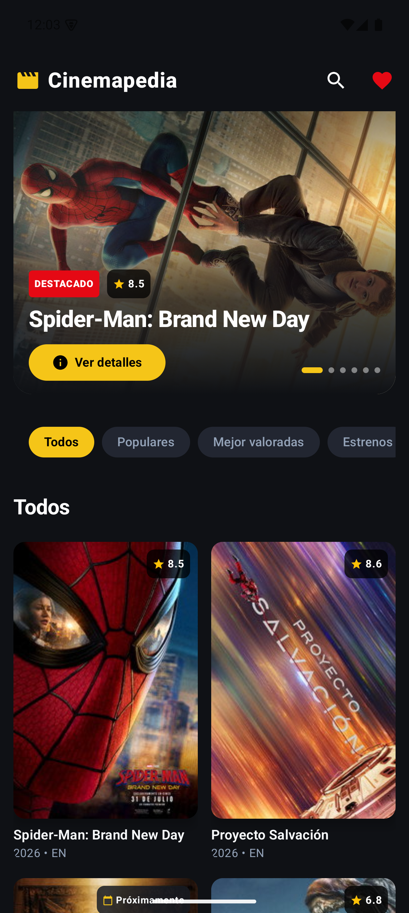
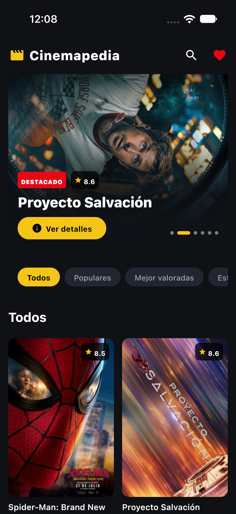
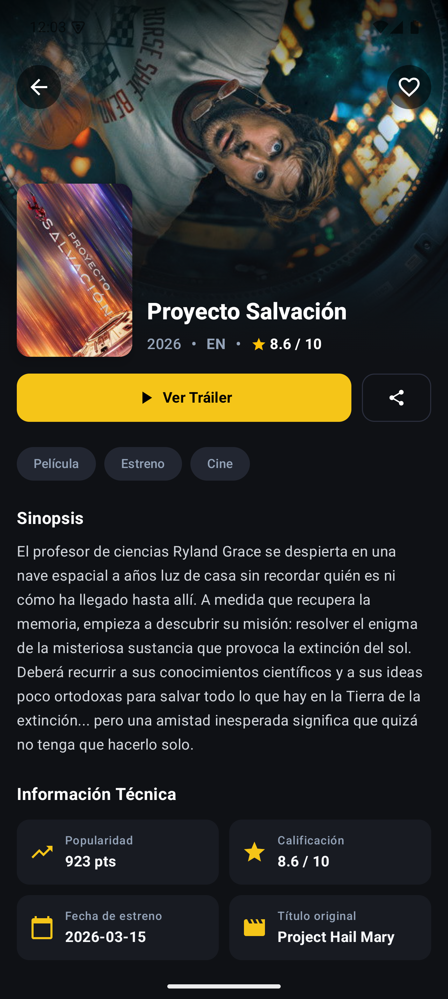
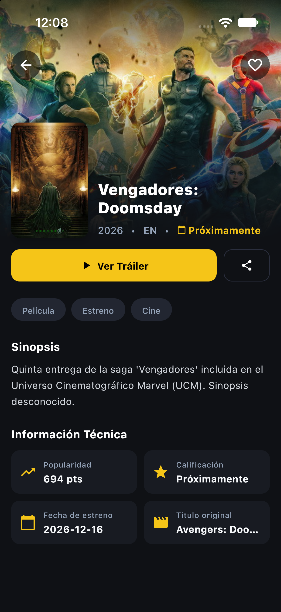
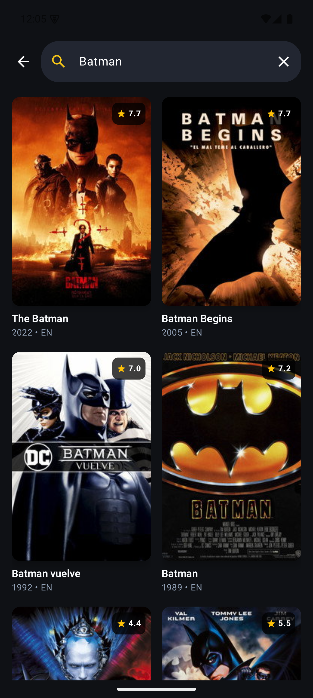
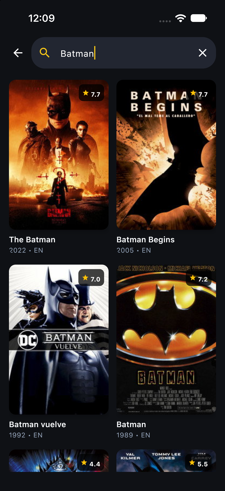
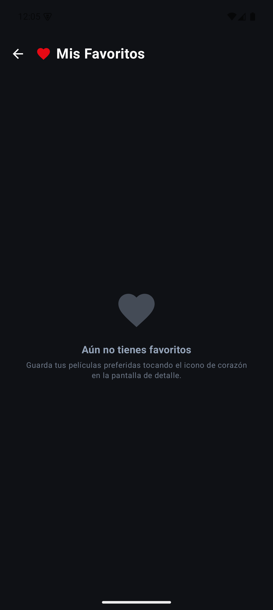
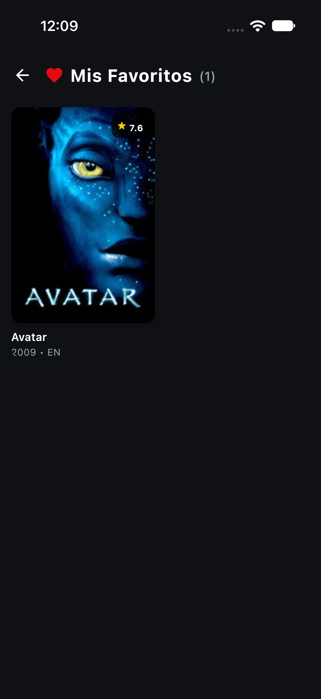

# Movieskmp · Cinemapedia

Aplicación de películas para **Android e iOS**, desarrollada con **Kotlin Multiplatform (KMP)** y **Compose Multiplatform**. Comparte la interfaz, los casos de uso y el acceso a datos. En la aplicación se muestra el nombre **Cinemapedia**.

Consulta [The Movie Database (TMDB)](https://www.themoviedb.org/), busca películas, revisa sus detalles y guarda tus favoritas en el dispositivo.

## Capturas de pantalla

Capturas reales de la aplicación instalada en un emulador Android y en un simulador de iPhone. Los títulos, imágenes y valoraciones dependen del contenido de TMDB; los favoritos se guardan por separado en cada dispositivo.

| Pantalla | Android | iOS |
| --- | --- | --- |
| Inicio y destacados |  |  |
| Detalle de película |  |  |
| Búsqueda |  |  |
| Favoritos |  |  |

## Funcionalidades

- **Catálogo:** cuadrícula adaptable con póster, título, año, idioma y valoración.
- **Destacados:** carrusel con hasta seis películas del catálogo, ordenadas por popularidad.
- **Filtros:** Todos, Populares, Mejor valoradas y Estrenos.
- **Búsqueda por título:** espera 400 ms después de escribir antes de consultar; muestra estados de carga, resultados, lista vacía y error.
- **Detalle:** portada, póster, título original, fecha de estreno, sinopsis, popularidad y calificación.
- **Tráileres:** abre un video de YouTube cuando TMDB devuelve uno disponible; prioriza los tráileres oficiales.
- **Favoritos locales:** agrega o quita películas desde el detalle y consulta la colección guardada con Room y SQLite.
- **Interfaz compartida:** tema oscuro, componentes Material 3 y navegación entre inicio, búsqueda, detalle y favoritos.

Los filtros trabajan sobre la lista descargada: Mejor valoradas ordena por puntuación y Estrenos por fecha. Todos y Populares usan la misma lista. El catálogo carga una página de resultados, sin paginación. Los favoritos se almacenan localmente; el catálogo, las búsquedas y los detalles necesitan conexión a TMDB.

## Tecnologías y versiones

- **Kotlin Multiplatform (KMP): 2.1.0**.
- **Compose Multiplatform: 1.7.0**.
- **Gradle: 8.9** · **Android Gradle Plugin: 8.5.2**.
- **Ktor, Koin , Room

Compatible con **Android 7.0+ (API 24)** e **iOS 15.3+**

## Requisitos

- Git.
- **JDK 17** para ejecutar Gradle con AGP 8.5.2. El objetivo JVM 11 del código Android es una configuración distinta del JDK que ejecuta la construcción.
- Android Studio con soporte para Kotlin y un Android SDK que incluya la plataforma 34.
- Emulador o dispositivo Android con API 24 o superior.
- Para iOS: macOS, Xcode con herramientas de línea de comandos y un simulador o dispositivo compatible. El repositorio no fija una versión concreta de Xcode.
- Una clave de API de TMDB y conexión a Internet para descargar dependencias y consultar películas.

No necesitas instalar Gradle por separado: utiliza el wrapper del repositorio.

## Clonar y configurar

### 1. Clonar el repositorio

```bash
git clone https://github.com/albinrk10/Movieskmp.git
cd Movieskmp
```

En macOS o Linux, si el wrapper no tiene permisos de ejecución:

```bash
chmod +x gradlew
```

### 2. Configurar el SDK y la clave de TMDB

Abre la carpeta raíz en Android Studio y sincroniza Gradle. Android Studio puede generar `local.properties` con la ruta del SDK. Agrega tu clave de API de TMDB a ese archivo, conservando la ruta del SDK:

```properties
# Ejemplo macOS: sustituye TU_USUARIO y la clave por tus valores.
sdk.dir=/Users/TU_USUARIO/Library/Android/sdk
TMDB_API_KEY=TU_CLAVE_TMDB
```

En Linux la ruta suele ser `/home/TU_USUARIO/Android/Sdk`. En Windows puedes usar barras `/`, por ejemplo `C:/Users/TU_USUARIO/AppData/Local/Android/Sdk`.

Obtén una API key desde la configuración de tu cuenta de [TMDB](https://www.themoviedb.org/). El cliente envía el parámetro `api_key`: utiliza la clave de API, no un token Bearer.

Como alternativa a guardar la clave en `local.properties`, puedes usar una variable de entorno:

```bash
# macOS / Linux, en la terminal desde la que ejecutarás Gradle
export TMDB_API_KEY="TU_CLAVE_TMDB"
```

```powershell
# Windows PowerShell
$env:TMDB_API_KEY = "TU_CLAVE_TMDB"
```

La propiedad de `local.properties` tiene prioridad sobre la variable de entorno, incluso si está vacía. Si no hay ninguna configurada, se genera una cadena vacía y las consultas no estarán autenticadas.

`local.properties` está ignorado por Git. BuildKonfig incorpora la clave en la aplicación durante la compilación: evita guardarla en el repositorio, pero no la convierte en un secreto inaccesible dentro del binario. Vuelve a compilar después de cambiarla. Si ejecutas desde Android Studio o Xcode, asegúrate de que la construcción reciba la variable, o utiliza `local.properties`.

## Ejecutar en Android

1. Abre el proyecto raíz en Android Studio y sincroniza Gradle.
2. Selecciona JDK 17 para Gradle.
3. Inicia un emulador o conecta un dispositivo con depuración USB.
4. Ejecuta la configuración del módulo `composeApp`.

También puedes compilar e instalar desde la raíz:

```bash
./gradlew :composeApp:assembleDebug
./gradlew :composeApp:installDebug
```

El APK se genera en `composeApp/build/outputs/apk/debug/composeApp-debug.apk`. `installDebug` requiere un dispositivo conectado; después abre Cinemapedia desde el dispositivo.

En Windows sustituye `./gradlew` por `.\gradlew.bat` en los comandos.

## Ejecutar en iOS

1. En macOS, configura JDK 17 y la clave de TMDB.
2. Abre el proyecto Xcode:

   ```bash
   open iosApp/iosApp.xcodeproj
   ```

3. Selecciona el esquema de la app y un simulador compatible; ejecuta con **Run**.
4. Para un dispositivo físico, configura tu equipo de desarrollo y la firma en Xcode. Los valores `TEAM_ID`, `BUNDLE_ID` y `APP_NAME` están en [Config.xcconfig](iosApp/Configuration/Config.xcconfig).

Xcode ejecuta `:composeApp:embedAndSignAppleFrameworkForXcode` para integrar el framework Kotlin. Ese paso depende del entorno de construcción de Xcode. La interfaz SwiftUI de `iosApp` presenta el `MainViewController` definido en Kotlin.

## Arquitectura

El proyecto utiliza **Clean Architecture** y **MVVM** en la presentación. Se organiza en tres capas:

- **Domain:** entidades, contratos de repositorios y casos de uso.
- **Infrastructure (datos):** implementación de repositorios, API con Ktor y persistencia con Room.
- **Presentation:** pantallas Compose y ViewModels con `StateFlow`.

**Koin** conecta las dependencias entre las capas. La interfaz y la lógica se comparten entre Android e iOS.

### Estructura del proyecto

```text
Movieskmp/
├── composeApp/
│   ├── build.gradle.kts
│   ├── schemas/                       # Esquemas de Room
│   └── src/
│       ├── commonMain/kotlin/io/albin/kmpmovies/
│       │   ├── App.kt                 # Composición raíz e inicio de Koin
│       │   ├── core/                  # Navegación, rutas, temas y diseño
│       │   ├── di/                    # Módulos de datos, dominio y ViewModels
│       │   ├── domain/                # Entidades, contratos y casos de uso
│       │   ├── infrastructure/        # Ktor, DTOs, mappers, Room y repositorios
│       │   └── presentation/          # Inicio, detalle, búsqueda, favoritos y componentes
│       ├── androidMain/               # MainActivity y base de datos Android
│       ├── iosMain/                   # MainViewController y base de datos iOS
│       ├── commonTest/                # Pruebas unitarias y de integración
│       └── androidInstrumentedTest/   # Pruebas de componentes Compose
├── iosApp/                            # Aplicación anfitriona SwiftUI y proyecto Xcode
├── gradle/libs.versions.toml           # Catálogo central de versiones
└── settings.gradle.kts
```

La presentación llama a los casos de uso de `domain`. Los repositorios de `infrastructure` consultan TMDB mediante Ktor o los favoritos mediante Room. Koin conecta las implementaciones con los ViewModels.

- [Navegación](composeApp/src/commonMain/kotlin/io/albin/kmpmovies/core/navigation/Navigation.kt) y [rutas](composeApp/src/commonMain/kotlin/io/albin/kmpmovies/core/routes/Routes.kt).
- [Entidad Movie](composeApp/src/commonMain/kotlin/io/albin/kmpmovies/domain/entities/Movie.kt) y [casos de uso](composeApp/src/commonMain/kotlin/io/albin/kmpmovies/domain/usecases).
- [Cliente remoto](composeApp/src/commonMain/kotlin/io/albin/kmpmovies/infrastructure/datasources/MoviesRemoteDataSource.kt) y [configuración de datos](composeApp/src/commonMain/kotlin/io/albin/kmpmovies/di/DataModule.kt).
- [Base de datos compartida](composeApp/src/commonMain/kotlin/io/albin/kmpmovies/infrastructure/datasources/database/AppDatabase.kt), con constructores por plataforma y generación mediante KSP.

### Consultas a TMDB

El cliente usa `https://api.themoviedb.org`, añade `language=es-ES` y realiza estas consultas:

| Recurso | Ruta | Propósito |
| --- | --- | --- |
| Catálogo | `/3/discover/movie?sort_by=popularity.desc` | Películas por popularidad |
| Detalle | `/3/movie/{id}` | Información de una película |
| Búsqueda | `/3/search/movie?query=...` | Buscar por título |
| Videos | `/3/movie/{id}/videos` | Obtener videos; solicita idiomas `es,en` |

## Pruebas

Las pruebas existentes cubren carga y filtros de inicio, estados y debounce de búsqueda, conversión de respuestas HTTP con `MockEngine` y comportamiento de favoritos con un DAO falso. Las instrumentadas verifican `MovieCard` y `FilterChipsRow`.

```bash
# Pruebas locales del destino Android, incluidas las de commonTest
./gradlew :composeApp:testDebugUnitTest

# Pruebas de interfaz; requiere emulador o dispositivo Android
./gradlew :composeApp:connectedDebugAndroidTest
```

Las pruebas del cliente remoto usan respuestas simuladas y no necesitan una clave real. Las pruebas de favoritos con DAO falso no verifican el motor SQLite real.
